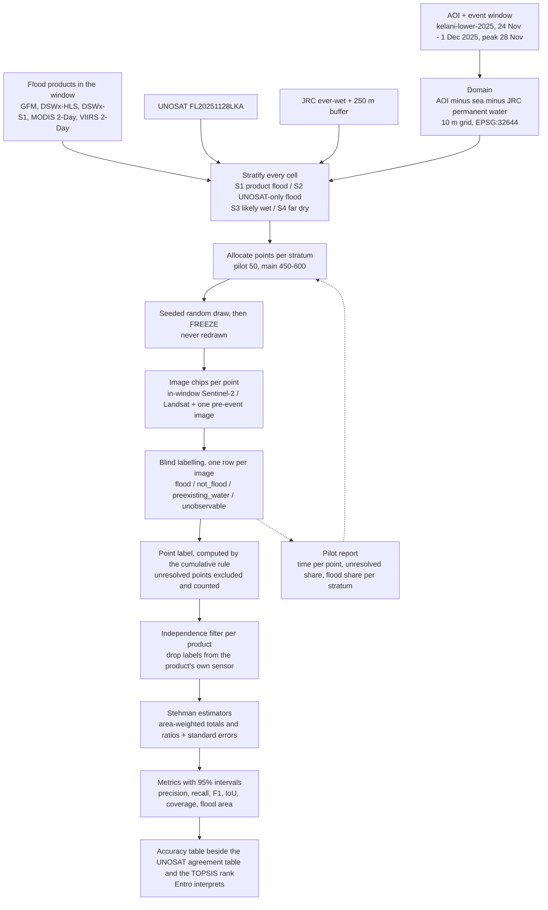

## Answer in one line

Points are drawn at random from four strata of the AOI, each labelled flood or
not flood by eye from satellite images the product did not use, and every
accuracy metric is estimated from those points with area weights
(Stehman 2014), so it comes with a 95% confidence interval instead of being a pixel count.

## Why a labelled sample, not only UNOSAT

The existing validation ([[Validation against the UNOSAT reference]]) compares
every product with the UNOSAT map pixel by pixel. That gives **agreement with
UNOSAT**, not accuracy. UNOSAT has no analysed extent and is cloud-limited (see
[[UNOSAT FL20251128LKA flood reference]]), so a product that sees flood UNOSAT
missed is scored as a false alarm.

The labelled sample gives **accuracy against an independent reference**. You
label it yourself, and every point has a known chance of being chosen. It also
measures how complete UNOSAT itself is. The two tables are reported side by
side.

## The flow

The dotted path is the pilot. It is labelled first, its report sets the main
sample's size and allocation, and its points are not reused.

## The steps and where they stand

| # | Step | Code / file | Status |
|---|---|---|---|
| 1 | Fix the AOI and the window | `validation/config.yaml`, `event.md` | done: `[79.94, 6.905, 80.09, 6.978]`, 24 Nov - 1 Dec, peak 28 Nov |
| 2 | Gather the products in the window | `scripts/fetch_opera_dswx.py`, `scripts/fetch_gibs_flood.py`, GFM via STAC | done; MODIS/VIIRS as 2-Day composites |
| 3 | Build the domain and the strata | `sample.frame()` | done |
| 4 | Draw and freeze the pilot | `sample.build(config, "pilot")` | done: 50 points, seed 20251021 |
| 5 | Render chips and label blind | `api/label_server.py` on port 8790 | done: 50 points, 100 rows |
| 6 | Pilot report and projection | `python -m core.workflows.validation.pilot <config>` | done: `sample/pilot/report.md` |
| 7 | Decide the main design | the user | **open**: S1 split, size, allocation |
| 8 | Draw and freeze the main sample | `sample.build(config, "main")` | to do |
| 9 | Label the main sample, plus a blind 10% repeat round | label tool, `round: qa` | to do |
| 10 | Estimate the metrics with intervals | `estimate.py` | code done and tested; runs after step 9 |
| 11 | Write the table, interpret it | `accuracy_metrics` + Entro | to do |

## Step 3 -- the strata

Every 10 m cell in the domain goes into exactly one stratum. The strata come
from the products and UNOSAT, not from what is true on the ground.

| Stratum | Rule | Why it exists | Pilot frame km2 | Main frame km2 |
|---|---|---|---|---|
| **S1** product flood | any product says flood | precision: points where a product claims flood | 16.95 | 18.68 |
| **S2** UNOSAT-only flood | UNOSAT says flood, no product does | flood the products missed | 11.45 | 10.68 |
| **S3** likely wet | dry in every map, but JRC ever saw water there or it is within 250 m of S1/S2 | where missed flood concentrates | 91.30 | 90.35 |
| **S4** far dry | everything else | rare missed flood, heavy weight | 14.01 | 14.00 |

- **Observed split.** S2-S4 are split into `.obs` / `.unobs`, depending on
  whether any product observed the cell. Here every cell was observed, so the
  `.unobs` parts are empty.
- **The main frame is bigger in S1.** It adds MODIS and VIIRS, which mark
  1.73 km2 of extra cells as product flood.
- **The 250 m buffer is an assumption** (no source yet). It decides only
  whether a dry cell lands in S3 or S4. It cannot bias any estimate, because
  every stratification is unbiased under these estimators. It changes where
  the points go, and so how wide the intervals are. The pilot found 27% flood
  in S3 and none in S4, so the split does separate likely-wet from dry ground.
- **Proposed, not decided: split S1.** In the main frame, 13.09 of S1's
  18.68 km2 is flood in DSWx-HLS alone, and DSWx-HLS cannot be scored with
  Sentinel-2 labels. The split would be:
  - S1a: flood in a scorable product (GFM, DSWx-S1, MODIS or VIIRS), 5.59 km2;
  - S1b: flood in DSWx-HLS only, 13.09 km2.

  Without it, even 600 points give DSWx-S1, MODIS and VIIRS about 10
  flood-mapped points each.

## Steps 4 and 8 -- allocation, draw, freeze

- **Allocation is chosen, not proportional.**
  - A small stratum like S1 gets many points so precision is measured well.
  - A big one like S3 gets enough for the flood area.
  - The design weights undo the imbalance: weight = stratum area / points in it.
- **The draw is seeded** (pilot 20251021, main 20251128) and without
  replacement.
- **Freezing writes `manifest.yaml` last.** Once it exists, the sample is never
  redrawn: redrawing after seeing labels is how a sample stops being a
  probability sample. The products' values at the points go to
  `product_values.csv`, which the labelling page never reads (blindness).
- **Pilot:** 11 / 11 / 11 / 17 points.
- **Main proposal:** 600 points, 200 S1a / 60 S1b / 80 S2 / 210 S3 / 50 S4, at
  about 17 s per point (about 3.5 h).

## Step 5 -- labelling

- **What you see.** One point at a time, in random order, with a red cross on
  the 10 m cell. For each in-window image there is true colour and false colour
  (SWIR/NIR/red), next to one pre-event image (S2 31 Oct).
- **What is hidden.** No stratum, no product value.
- **One row per image:**
  - `flood`: new standing water, absent before;
  - `not_flood`;
  - `preexisting_water`: paddy, tank or channel water already there before;
  - `unobservable`: cloud, cloud shadow, canopy, built-up or no image.

  Each row also carries a confidence of 1-3.
- **Only images inside the window are used** (user decision). Here that is
  Sentinel-2 25 Nov and 30 Nov. The only Landsat pass, 27 Nov, was 100% cloud.

## The point label -- the cumulative rule

The label of a point is **computed from its rows, never typed**
(`estimate.point_label`):

1. **flood** if any in-window image shows flood;
2. else **not_flood** (or **preexisting_water**) if a clear image **on or after
   the peak day** shows it;
3. else **unresolved**. It is excluded and counted, never guessed. Within its
   stratum it is assumed missing at random.

`preexisting_water` counts as not flood in every metric. The peak day is a
local day (Sri Lanka, UTC+5:30).

## The independence filter

A product is scored only on labels from images **its own sensor did not
take** (`estimate.independent_of`). The point is relabelled from the remaining
rows for that product alone.

| Label image | GFM | DSWx-S1 | DSWx-HLS | MODIS / VIIRS | UNOSAT |
|---|---|---|---|---|---|
| Sentinel-2 | yes | yes | **no** | yes | same source -- scored, flagged |
| Landsat | yes | yes | **no** | yes | yes |

So **DSWx-HLS cannot be scored** in this experiment: every label is
Sentinel-2. Its row says so instead of carrying a number. UNOSAT is scored on
the same Sentinel-2 labels it was made from, so its agreement is inflated,
and the table says that too.

## Step 10 -- the estimators (Stehman 2014)

The strata are not any one product's classes: one stratification serves five
products and UNOSAT. Olofsson et al. (2014) set the good-practice rules:
- a probability sample;
- area weights, not pixel counts;
- a confidence interval with every estimate.

Their formulas assume the strata are one map's classes. Stehman (2014) gives
the estimators for the case here, which is also why a product added after the
freeze can still be scored on the same points.

**Everything is a total or a ratio of two totals.** For one stratum *h*, with
N_h cells and n_h resolved points, the mean of an indicator y over its points
is ybar_h. The domain total is

> Y = sum over h of N_h x ybar_h

Each point stands for N_h / n_h cells: that is its **weight**.

A ratio is R = Y / X, two such totals. Its variance:

> Var[R] = (1 / X^2) x sum over h of N_h^2 (1 - n_h/N_h) (s2_yh + R^2 s2_xh - 2 R s_xyh) / n_h

Here s2 and s_xy are the sample variance and covariance inside the stratum.
The 95% interval is R +/- 1.96 x sqrt(Var[R]).

**A small worked example.** Stratum A is 10 km2 with 5 points, 4 of them
flood. Stratum B is 90 km2 with 5 points, 1 of them flood.

- Flood area = 10 x 4/5 + 90 x 1/5 = 8 + 18 = **26 km2**.
- A pixel count would say 5 of 10 points, i.e. 50 km2.
- The one flood point in B stands for 18 km2, nine times the weight of a point
  in A.

## Step 10 -- from labels to the final metrics

For each point and each product there are three indicators:
- r = 1 if the point's label is flood;
- m = 1 if the product says flood there;
- c = 1 if the product observed the point.

Each metric is a ratio of two weighted totals:

| Metric | Numerator total | Denominator total | Plain meaning |
|---|---|---|---|
| Precision | r * m * c | m * c | of what the product calls flood, the share that is flood |
| Recall | r * m * c | r * c | of the real flood it observed, the share it caught |
| IoU | r * m * c | max(r, m) * c | overlap over union of the two flood areas |
| F1 | 2 * r * m * c | (r + m) * c | balance of precision and recall |
| Coverage | c | 1 | share of the domain the product observed |
| Flood area | r | -- | a total, times the 10 m cell area (0.0001 km2) |
| UNOSAT completeness | UNOSAT as the map | | UNOSAT's own recall and precision |

Rules applied to every number:
- **Coverage travels with every metric.** A product's precision and recall
  describe only the ground it observed.
- **An undefined value is n/a, not 0.** GFM maps no flood in this window, so
  its precision has no denominator.
- **A stratum with fewer than 2 resolved points has no standard error**, and
  the interval is withheld.
- **The usable-points check.** The main frame warns when a product has fewer
  than 50 points in its flood or in its dry ground. The row is still reported,
  with the count beside it.

## What the pilot measured (planning numbers, not thesis results)

From `sample/pilot/report.md`, 50 points:
- **17 s per point** (median).
- **25 Nov was cloud at all 50 points**, so every label rests on 30 Nov.
- **49 of 50 points resolved.**
- **Flood share by stratum:** S1 0.82, S2 0.91, S3 0.27, S4 0.
- **Flood area about 49 +/- 26 km2**, against 20.5 km2 mapped by UNOSAT.
- **GFM maps 0 km2 of flood** in the window.
- **DSWx-S1's only pass (26 Nov) is before the peak.**

## What this validation cannot say

- **Labels are from 30 Nov, two days after the peak.** A cell already dry by
  then is labelled not flood, so the labelled flood is a lower bound for the
  peak.
- **One labeller.** The intervals cover sampling error only. A blind repeat of
  10% of points about a week later measures your own consistency, not error
  between labellers, and the thesis says which.
- **DSWx-HLS has no independent label image** here.
- **The 250 m buffer has no source yet** (TODO(sample-buffer)).
- **Below about 50 points per stratum, ratio standard errors run 5-20% low**
  when flood is rare. The pilot intervals are therefore optimistic.

## Sources

(Olofsson et al. 2014) and (Stehman 2014) -- full references in
[[Flood map validation - sources]]. Repo design record:
`docs/sample_reference.md`.

---

Related: [[Uncertainty Analysis - MOC]] | [[Validation against the UNOSAT reference]] | [[UNOSAT FL20251128LKA flood reference]] | [[Agreement metrics for binary flood maps]] | [[Flood map validation - sources]] | [[Accuracy metrics payload fields]]
